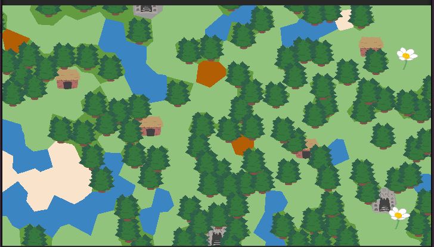
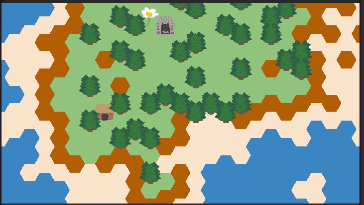
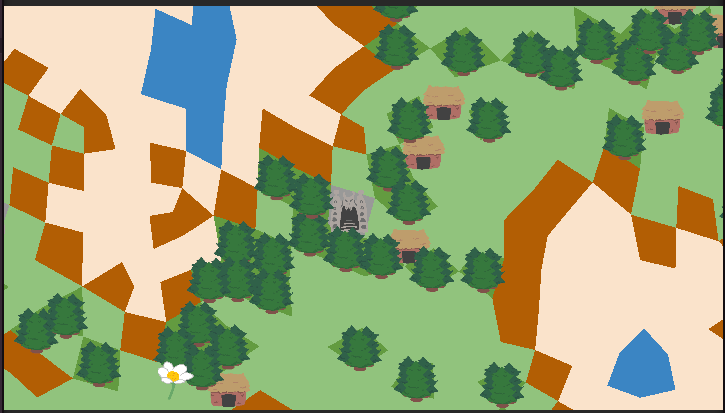

# Wave Function Collapse on Irregular Grids

A unity project that runs to generate a map of a level on various types of grids using Wave Function Collapse. Wave Function Collapse is a procedural generation method that uses a set of rules least entropy heuristic to fill out a grid. Every tile has a set of rules of what it is and is not allowed to be nearby. The algorithm alternates between updating each tile’s “entropy” (what it could end up being based off nearby tiles’ rules) and collapsing the tile with the least entropy (setting a tile to only have one potential type; to be that type).  

## Grid types include: 
    
- **Voronoi Grids**, a type of grid generated from a set of randomly placed nodes. The cells are formed in such a way that any given point on the grid is located within the cell corresponding to its nearest node. The resulting graph is made up of convex polygons of all different shapes and sizes. We have smoothed the random placement of points out to make the cells evener in size. 
- **Townscaper Grids**, a type of grid formed from merging and subdividing triangles into quads, then smoothing them out, resulting in a graph that's made of quads of varying shapes that are nearly even in size and shape to their neighbours. 
- **Perturbed Hex Grids**, hex grids that have had their corners randomly moved to make them appear to be randomly shaped, while still keeping all the order that regular hex grids have 
- **Regular Grids**, the project also includes square, hex, and tri grids. 

## Controls
| Input | Effect |
| -- | -- |
| R | Generate New Grid |
| [ | Previous Grid Type  |
| [ | Next Grid Type  |
| T | Toggle between tile by tile generation / Entire map at once generation |
| O | Toggle Grid Outline |

## Config
In /WFC_OddGrids/Assets/Data are the files that hold the data. These are as follows:

---

### tileTypeIndex.csv
This contains the data for each tile type, each line is contains each piece of information a tile needs. 

The CSV is formatted as follows:
| Tile ID | Tile Name | Tile Weight | Color (Red) | Color (Green) | Color (Blue) | Required min after generating | Amount forced to generate at start of generation |
| - | - | - | - | - | - | - | - |

Note: _Tile ID_ should be the same as the order the tiles are in the list. The scripts do not read the _Tile ID_ or _Tile Name_ columns, they are solely there to make the table more readable by humans.

---

### tileNeighbourMinIndex.csv and tileNeighbourMaxIndex.csv
These tables contain the data for tile neighbour relationships. Each cell corresponds to tile A's relationship with tile B

The CSV is formatted as follows:
| ID0's min/max of ID0 | ID0's min/max of ID1 | ID0's min/max of ID2 |
| -- | -- | -- |
| ID1's min/max of ID0 | ID1's min/max of ID1 | ID1's min/max of ID2 |
| ID2's min/max of ID0 | ID2's min/max of ID1 | ID2's min/max of ID2 |

For example:
If this was _tileNeighbourMaxIndex.csv_, tile ID 0 would never generate with more than 1 tile of ID 1 adjacent to it, and tile ID 1 and 2 would never generate next to each other

| 16 | 1 | 3 |
| -- | -- | -- |
| 4 | 16 | 0 |
| 16 | 0 | 16 |

## Sample Outputs

|  |  |
| -- | -- |
|  | .png) |

## Other

Sylves library: https://www.boristhebrave.com/docs/sylves/1/articles/index.html
